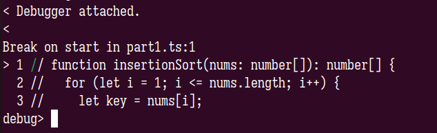
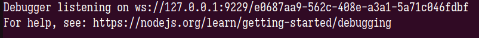
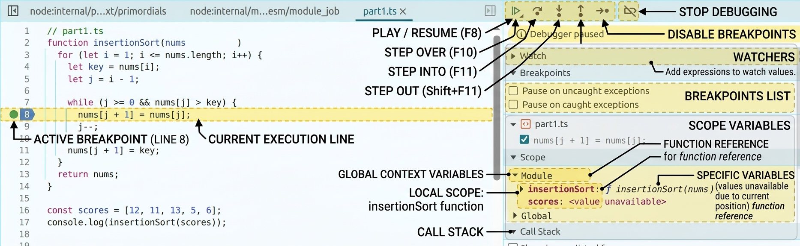

# Introduction 

Finding and fixing software errors is as fundamental to programming as writing the code itself. Ever since early computer pioneers manually traced memory dumps, debugging tools have evolved to give developers unprecedented control over execution. In modern backend development, particularly when working with  Node.js and TypeScript, debuggers transform how we diagnose errors, replacing speculative console logs with real-time inspection, interactive execution control, and deep visibility into runtime state.

## The Goat, console.log()

While print-debugging is reliable and well-loved, relying on it as your primary diagnostic tool quickly becomes frustrating for a few reasons :

1. **Code Pollution:** You are constantly editing source code, re-running the app, and inevitably hunting down rogue log statements before opening a pull request. A debugger attaches directly to your running runtime without touching a single line of code.    
2. **Loss of State and Context:** A log statement gives you a static snapshot of one variable at one moment in time. A debugger lets you freeze time, inspect the full call stack, step through asynchronous logic line by line, and evaluate expressions on the fly.

Stepping away from speculative print statements and adopting a real-time debugger turns hours of tedious trial-and-error into structured problem-solving.


## Debugger

When you are ready to ditch `console.log()` and dive into real debugging, Node.js gives you a brilliant built-in shortcut right out of the box: the `debugger;` statement.

Dropping the `debugger;` keyword directly into your TypeScript code acts as an immediate software emergency brake. When Node hits it, execution freezes dead in its tracks. when running in inspect mode  using:
```sh
node inspect src/index.ts
```

the  process will drop into debug mode on the first line  where you can type commands to control the debugger.




While you can casually type `cont` or `c` into your terminal to make execution jump straight to your embedded `debugger;` statement or wrestle with commands like `step`, `next`, and `repl` , this approach quickly hits a wall. For starters, you are right back to the exact code pollution problem we tried to escape  forcing you to litter your pristine source files with statements you have to manually hunt down and clean up later. Besides,  let’s be honest, when your application is behaving like it's possessed and spinning out of control, nobody actually wants to diagnose a complex, multi-layered bug through a cramped, line-by-line terminal prompt.
### Chrome DevTools: The Familiar Face

One of the easiest ways to inspect a Node.js process is by using a tool you probably already have open in another window,  **Chrome DevTools**. By launching your app with the inspection flags, you can hook your backend directly into the browser.

```sh
node --inspect-brk src/part1.ts
```



Once you are inside the DevTools panel, a few core features do all the heavy lifting:

1. **Breakpoints:** Think of these as flags planted in your code. They tell the runtime to pause execution precisely  before a line runs  giving you time to analyze the scene.These can be added by clicking besides the line number on the code panel.
2. **Scope:** Say goodbye to guessing. The scope panel instantly reveals every local, closure, and global variable in existence at that exact moment, handy when tracking down that pesky `this` context when callbacks or mismanaged bindings leave you wondering if it's pointing to your class instance, the global object, or `undefined`.
3.  **Watch Expressions:** If you care about a specific variable or a complex boolean condition, you can pin it to a live sidebar watch list to watch it morph as you step through your code.
4. **Call Stack:** When a function throws an error deep inside a utility file, the call stack unmasks the breadcrumb trail, showing you the exact chain of command that led you into this mess.

## A trivial example.

It’s easy enough to spot a missing property name or a basic syntax typo. But what happens when your code is syntactically pristine yet behaves like it's possessed? Let's look at a classic implementation of **Insertion Sort** in TypeScript that looks completely correct on the surface, but harbors a subtle boundary bug.

```ts
// part1.ts

function insertionSort(nums: number[]): number[] {

for (let i = 1; i <= nums.length; i++) {

let key = nums[i];

let j = i - 1;

  

while (j >= 0 && nums[j] > key) {

nums[j + 1] = nums[j];

j--;

}

nums[j + 1] = key;

}

return nums;

}

const scores = [12, 11, 13, 5, 6];

console.log(insertionSort(scores));
```

You fire up your script with inspection enabled
```sh
node --inspect-brk  src/part1.ts
```

  Open Chrome DevTools , and navigate to : chrome://inspect/#devices 
  you should see your process under remote target #localhost click on "inspect fallback " 
  Add a breakpoint by clicking to the left of the line number on the source code panel,  in this case line 8.


#### Watching Variables & Unmasking the Culprit

Instead of guessing why things went off the rails, you turn your attention to the DevTools panels:

1) **The Scope Panel:** You check the local scope on the final iteration of the outer loop. Right there, you notice `i` has ticked up to `5`—matching `nums.length`. Because the loop condition used `<=` instead of `<`, `i` overshot the array's boundaries.

2) **The Watch Expressions Panel:** You pin `i`, `nums.length`, and `key` to your live watch sidebar. As you step through the execution, you watch `key` evaluate to `undefined` because `nums[5]` doesn't exist. That `undefined` value silently trickles into your comparison logic, contaminating the rest of the array sorting.
In a few seconds, the debugger exposes an off-by-one boundary breach that a dozen `console.log()` statements would have forced you to sift through like a crime scene investigator.

By now, the benefits of ditching `console.log()` for a proper debugger are crystal clear. Instead of guessing, recompiling, and drowning your terminal in print statements, you get a front-row seat to your application's inner workings, stopping  time, inspecting memory, and unmasking sneaky boundary bugs in seconds rather than hours.

This is just Part 1 of our debugging journey, and we have only scratched the surface of what modern runtime tooling can achieve. In the next installment of this series, we will take things a step further by diving into advanced workflows like conditional breakpoints to target specific loop iterations, complex expression watchers to evaluate code on the fly, and mastering deep asynchronous call stacks and closure scopes without losing your mind.

If you want to read ahead on the underlying runtime inspector flags and protocols before Part 2 drops, take a look at the [Node.js Official Documentation](https://nodejs.org/api/debugger.html).